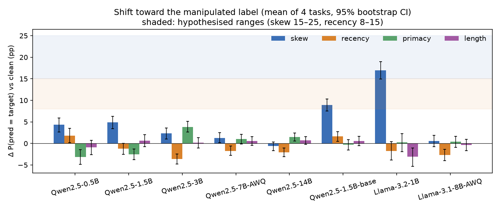
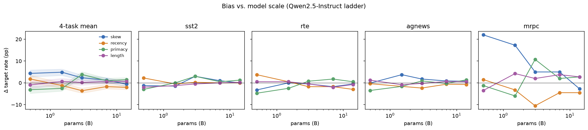
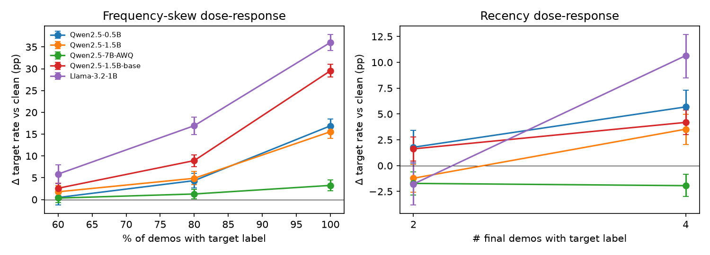
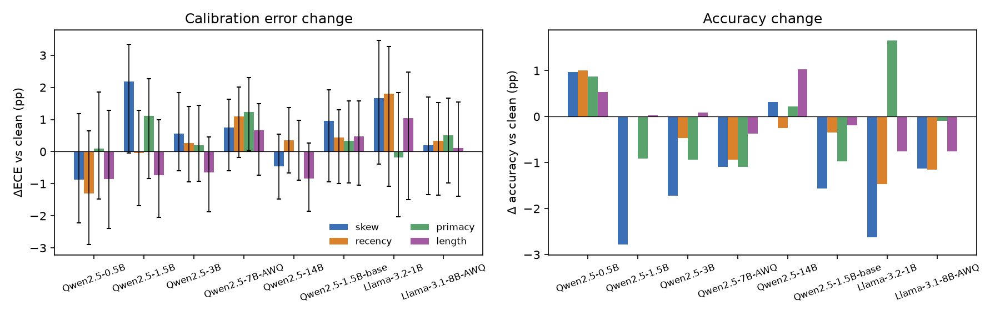

# In-Context Learning Label Bias: When Demonstrations Teach the Wrong Lesson

## 1. Executive Summary

**Question.** When few-shot demonstrations carry a spurious statistic, how far do LLM predictions move toward the label that statistic favours? We test four such statistics: label frequency skew, recency, label position (primacy), and label-length correlation. We also ask whether the effect changes with model scale.

**Answer.** In modern instruction-tuned models (Qwen2.5-Instruct 0.5B–14B; Llama-3.2-1B and Llama-3.1-8B), every one of these biases is much smaller than hypothesised. Across 80,000 scored prompts (8 models × 10,000):

- **Frequency skew (80/20)** is the largest bias in small models: +4 to +5 pp for small Qwen-Instruct, +8.9 pp for a 1.5B *base* model, and +16.9 pp for Llama-3.2-1B. It shrinks with scale to roughly zero at 14B (−0.6 pp) and 8B (+0.6 pp).
- **Recency** (last two demos share a label) does not produce the predicted 8–15 pp pull. From 3B upward it produces a small but significant *anti*-recency effect: −1.7 to −3.6 pp, Holm-corrected p < 0.05.
- **Label-length correlation** has no reliable effect at any size (|Δ| ≤ 3 pp; no model shows a length → label rule).
- **Calibration error (ECE)** does not increase reliably under any bias. Only 1 of 32 ΔECE bootstrap CIs excludes zero, and only barely and before multiplicity correction.

Shifts large enough to match the hypothesis appear only with extreme manipulations, mostly on the most ambiguous task (MRPC). Examples: 100% single-label demos give +16 to +36 pp in ≤1.5B models (but only +3.2 pp in Qwen-7B), and skew on MRPC gives +17 to +42 pp.

**Practical implication.** For current instruction-tuned models at ≥3B, the *specific* labels in a balanced-looking demo set matter less than ordinary demo-to-demo variance. Swapping one balanced demo set for another flips 4–23% of predictions, which is larger than any systematic bias we measured in ≥3B models. Practitioners should worry about ambiguous tasks and very small models, where skew still matters, and should average over demo sets rather than tune label order.

## 2. Research Question & Hypothesis

The hypothesis under test has five parts:

- **H1.** Frequency skew gives the largest bias: a 15–25 pp shift toward the majority label.
- **H2.** Recency gives the second largest: 8–15 pp.
- **H3.** Label-length correlation gives a moderate bias (5–10 pp) that is hard to overcome with scale.
- **H4.** Larger models partially correct frequency skew but amplify recency bias.
- **H5.** Calibration error increases monotonically with all bias types.

**Motivation / gap.** Zhao et al. (2021, *Calibrate Before Use*) documented majority-label and recency bias in GPT-3-era base models. Fei et al. (2023) added domain-label bias. Lu et al. (2022) showed that demonstration order matters. Those studies mostly varied one factor on older base models. Here all four manipulations are measured with one paired protocol, across a dense scale ladder of a modern instruction-tuned family plus a second family, and calibration is reported for each bias type. (Note: the resource-finder stage did not run for this workspace, so there was no `literature_review.md`, papers or code. The background above comes from known literature, not from downloaded PDFs.)

## 3. Experimental Setup

### Tasks and data
| Task | Type | Labels (verbalisers) | Test items | Demo pool |
|---|---|---|---|---|
| SST-2 | sentiment | negative / positive | 200 from validation (100/100) | train, 5–60 words |
| RTE | NLI | yes (entail) / no | 200 from validation (100/100) | train, ≤80 words |
| AG News | topic, 4-way | World / Sports / Business / Technology | 200 from test (50 each) | train, ≤80 words |
| MRPC | paraphrase | no / yes | 200 from validation (100/100) | train, ≤70 words |

SST-2 and AG News come from the local HF cache. RTE and MRPC come from `nyu-mll/glue` parquet files (`datasets/raw/`). Demos come from train and test items from validation/test, so the two never overlap.

### Manipulations
Every prompt has k = 10 demonstrations. The *target label* T is rotated through every label, so a model's intrinsic label preference cancels out.

| Condition | Label counts | Order | Lengths |
|---|---|---|---|
| clean | balanced (5/5; 3/3/2/2 for AG News) | random | random |
| skew | 8 × T, 2 × other (80/20) | random | random |
| recency | balanced | last 2 demos = T | random |
| primacy (label-position) | balanced | first 2 demos = T | random |
| length | balanced | random | T demos from the longest third of T's pool, others from the shortest third (mean +15 to +29 words for T) |

"Label-position correlation (label always near sentence start)" was interpreted as *prompt-level* position (T demos placed first, i.e. primacy). That makes it the mirror image of recency.

Each (task, item, T, condition) gets its own seeded demo sample. This gives 10,000 prompts, and every model sees exactly the same prompts.

**Supplementary dose-response set** (`prompts_supp.jsonl`, 6,000 prompts): skew at 60% and 100%, and recency with the last 4 demos = T. In AG News, recency4 necessarily raises T's share to 40%.

Prompt format (raw completion, no chat template), shown for SST-2:
```
Classify the sentiment of each movie review as positive or negative.

Review: <demo text>
Sentiment: positive

... (10 demos) ...
Review: <test text>
Sentiment:
```

### Models
All models run locally with vLLM 0.32 (bf16 unless noted), greedy decoding, on a single shared RTX A6000 (48 GB) slice per run:

- Qwen2.5-Instruct: 0.5B, 1.5B, 3B, **7B-AWQ** (4-bit), 14B
- Qwen2.5-1.5B **base** (to test the effect of instruction tuning)
- Llama-3.2-1B-Instruct
- Llama-3.1-8B-Instruct-AWQ-INT4

The 7B and 8B models had to use 4-bit AWQ checkpoints because other users' jobs left ≤17 GB free on the shared GPUs. No API keys were available on this host, and the task asked for local models. vLLM was used instead of Ollama because it exposes exact label log-probabilities.

**Scoring.** Each prompt is scored by the next-token distribution restricted to the first token of each label word (with leading space), renormalised over the label set (`allowed_token_ids` + `logprobs_mode="processed_logprobs"`). The prediction is the argmax. This removes format and parsing failures and yields probabilities for calibration.

### Metrics
- **Target shift Δ** (primary): P(pred = T | condition) − P(pred = T | clean), paired on (task, item, T), in percentage points. It is averaged over T and items, then over the 4 tasks with equal weight.
- Accuracy and Δaccuracy, both overall and split by whether gold = T.
- **ECE**: 10 equal-width bins on max-probability confidence, computed per task and then averaged.
- Normalised predictive entropy.
- Mean probability mass on T (a soft version of Δ).
- **Noise floor**: the flip rate between two independent clean demo sets for the same item.

### Statistics
- 95% CIs come from a cluster bootstrap over test items, resampled within each task (2,000 resamples; 1,000 for ΔECE, paired).
- Significance uses sign-flip permutation tests on per-item Δ, Holm-corrected over all 32 (model × condition) tests.
- Scale trend: OLS slope of Δ on log10(params) along the Qwen-Instruct ladder, plus Spearman ρ across the 5 sizes.

Seeds: demo sampling is seeded by an md5 hash of (task, item, T, condition); vLLM seed = 0; analysis RNG seed = 0.

## 4. Results

### 4.1 Target shift by bias type (Figure 1)

Δ is in pp. Brackets give the 95% CI; * marks Holm-adjusted p < 0.05.

| Model | skew (80/20) | recency | primacy | length |
|:--|:--|:--|:--|:--|
| Qwen2.5-0.5B | **+4.3** [+2.7,+5.9]* | +1.8 [+0.2,+3.5] | −3.1 [−4.8,−1.5]* | −0.9 [−2.6,+0.7] |
| Qwen2.5-1.5B | **+4.9** [+3.4,+6.3]* | −1.2 [−2.5,−0.0] | −2.5 [−3.8,−1.3]* | +0.7 [−0.7,+2.0] |
| Qwen2.5-3B | +2.3 [+1.1,+3.6]* | −3.6 [−4.8,−2.4]* | **+3.8** [+2.7,+5.1]* | +0.2 [−1.0,+1.3] |
| Qwen2.5-7B-AWQ | +1.3 [+0.2,+2.5] | −1.7 [−2.8,−0.6]* | +1.0 [−0.1,+2.1] | +0.6 [−0.4,+1.6] |
| Qwen2.5-14B | −0.6 [−1.7,+0.3] | −2.1 [−3.1,−1.1]* | +1.5 [+0.6,+2.4]* | +0.7 [−0.2,+1.6] |
| Qwen2.5-1.5B-base | **+8.9** [+7.6,+10.3]* | +1.6 [+0.5,+2.7] | −0.3 [−1.5,+0.8] | +0.5 [−0.5,+1.6] |
| Llama-3.2-1B | **+16.9** [+14.9,+19.0]* | −1.8 [−3.8,+0.4] | +0.2 [−1.9,+2.3] | −3.1 [−5.3,−1.1] |
| Llama-3.1-8B-AWQ | +0.6 [−0.8,+1.8] | −2.7 [−4.0,−1.3]* | +0.4 [−0.9,+1.7] | −0.3 [−1.7,+1.0] |



*Figure 1. Shift toward the manipulated label, as a 4-task mean with 95% bootstrap CIs. Shaded bands mark the hypothesised ranges. Only Llama-3.2-1B under skew reaches the 15–25 pp band.*

**Skew effects are concentrated in the ambiguous tasks.** Per-task skew Δ in pp (from `results/target_shift.csv`):

| Model | SST-2 | RTE | AG News | MRPC |
|---|---|---|---|---|
| Qwen2.5-0.5B | −1.2 | −3.2 | −0.1 | +22.0 |
| Qwen2.5-1.5B | −1.5 | 0.0 | +3.8 | +17.2 |
| Qwen2.5-3B | +3.0 | −0.5 | +1.8 | +5.0 |
| Qwen2.5-7B-AWQ | +1.0 | −1.8 | +0.9 | +5.0 |
| Qwen2.5-14B | 0.0 | −0.5 | +0.8 | −2.8 |
| Qwen2.5-1.5B-base | −1.5 | +7.8 | +9.8 | +19.8 |
| Llama-3.2-1B | +3.8 | +22.2 | 0.0 | +41.8 |
| Llama-3.1-8B-AWQ | −0.8 | +2.5 | −5.1 | +5.8 |

SST-2 is essentially immune to skew in every model. MRPC, the task where models are least certain (clean accuracy is lowest and the flip rate is highest), carries most of the skew bias.

**Where skew hurts.** Accuracy under skew, split by whether gold = T:

| Model | gold ≠ T: clean → skew | gold = T: clean → skew |
|---|---|---|
| Llama-3.2-1B | 73.3 → **58.8** | 72.0 → 86.2 |
| Qwen2.5-1.5B-base | 79.8 → 70.1 | 79.2 → 88.4 |
| Qwen2.5-1.5B | 80.5 → 74.2 | 82.1 → 84.2 |
| Qwen2.5-14B | 87.2 → 87.7 | 87.1 → 86.9 |

For minority-class items in the most-affected model, skew costs 14.5 pp of accuracy. Because T is rotated, these gains and losses cancel in overall accuracy, which changes by at most 2.8 pp (Figure 3, right).

### 4.2 Scale (Figure 2)



*Figure 2. Δ against parameter count for the Qwen2.5-Instruct ladder: 4-task mean with CI band, then each task.*

OLS slope of Δ per 10× parameters, Qwen-Instruct ladder (n = 5 sizes; the CI covers item-sampling noise only):

| Bias | Slope (pp / decade) | 95% CI | Spearman ρ |
|---|---|---|---|
| skew | −3.7 | [−4.8, −2.4] | −0.9 |
| recency | −2.4 | [−3.6, −1.2] | −0.7 |
| primacy | +3.6 | [+2.4, +4.7] | +0.7 |
| length | +1.0 | [−0.2, +2.2] | +0.7 |

The Llama pair agrees for skew: 1B gives +16.9 and 8B gives +0.6. It also agrees for recency: 1B gives −1.8 (n.s.) and 8B gives −2.7*.

### 4.3 Dose-response (supplementary; Figure 4)

Δ in pp, 4-task mean, 95% CI:

| Model | skew 60% | skew 80% | skew 100% | recency last-2 | recency last-4 |
|---|---|---|---|---|---|
| Qwen2.5-0.5B | +0.5 [−1.2,2.0] | +4.3 | +16.9 [15.4,18.5] | +1.8 | +5.7 [4.2,7.3] |
| Qwen2.5-1.5B | +1.8 [0.5,3.2] | +4.9 | +15.6 [14.0,17.2] | −1.2 | +3.5 [2.0,5.0] |
| Qwen2.5-1.5B-base | +2.6 [1.5,3.8] | +8.9 | +29.5 [28.0,31.0] | +1.6 | +4.2 [3.0,5.4] |
| Llama-3.2-1B | +5.8 [3.7,7.9] | +16.9 | +36.0 [34.1,38.0] | −1.8 | +10.7 [8.5,12.7] |
| Qwen2.5-7B-AWQ | +0.3 [−0.7,1.4] | +1.3 | **+3.2** [2.0,4.5] | −1.7 | **−1.9** [−3.0,−0.8] |

(`results/dose_response.csv`.)



Skew bias rises steeply and non-linearly with the share of majority labels. Most of the effect appears only when the minority label is (nearly) absent from the context. A recency run of 4 identical final labels produces a positive recency effect in small models even where a run of 2 does not. **Qwen2.5-7B is almost immune even to the extreme doses.** All-T demonstrations move it by only +3.2 pp, and four final T demos still produce anti-recency (−1.9 pp). Scale therefore removes not just the moderate biases but most of the dose-response.

### 4.4 Calibration, entropy, accuracy (Figure 3)

ECE (equal-task mean):

| Model | clean | skew | recency | primacy | length |
|---|---|---|---|---|---|
| Qwen2.5-0.5B | .071 | .062 | .058 | .072 | .062 |
| Qwen2.5-1.5B | .049 | .070 | .048 | .060 | .041 |
| Qwen2.5-3B | .121 | .127 | .124 | .123 | .114 |
| Qwen2.5-7B-AWQ | .111 | .118 | .121 | .123 | .117 |
| Qwen2.5-14B | .097 | .092 | .101 | .097 | .089 |
| Qwen2.5-1.5B-base | .058 | .067 | .062 | .061 | .063 |
| Llama-3.2-1B | .035 | .051 | .053 | .033 | .045 |
| Llama-3.1-8B-AWQ | .053 | .055 | .056 | .058 | .055 |

- ΔECE vs clean (`results/calibration_delta.csv`) ranges from −1.3 to +2.2 pp. **Only 1 of 32 CIs excludes zero**: 7B primacy, +1.2 [+0.02, +2.3], uncorrected for 32 comparisons. The largest point estimate, Qwen-1.5B skew (+2.2 [−0.05, 3.3]), does not. 9 of 32 point estimates are negative.
- Normalised entropy hardly moves (e.g. 14B: 0.099 clean vs 0.102 skew).
- Larger Qwen models are markedly *over*confident even on clean prompts (ECE ≈ 0.10–0.12 at 3–14B vs 0.05–0.07 at 0.5–1.5B). This is a property of the model, not of the bias.



### 4.5 Length interaction and noise floor

- **Length.** If the length manipulation taught a "long → T" rule, Δ would be larger for long test inputs (above the task median) than for short ones. The long-minus-short difference ranges from −0.6 to +1.9 pp, and every 95% CI includes 0 (`results/length_interaction.csv`). There is no evidence of a learned length → label rule.
- **Noise floor.** Re-drawing a *balanced* demo set flips 4.2% (Qwen-14B) to 22.8% (Llama-1B) of predictions; MRPC reaches 41.5% for Llama-1B. For every model ≥3B, this ordinary resampling instability is larger than any systematic bias in Table 4.1.

## 5. Analysis & Discussion

### Verdicts on the hypothesis
| Part | Prediction | Result | Verdict |
|---|---|---|---|
| H1 | skew is largest, 15–25 pp | Largest bias in every model ≤1.5B (4.3–16.9 pp), but only Llama-3.2-1B is in range. ≈0 at 8–14B. | **Partly supported**: largest in small models, magnitude far too high for instruct models |
| H2 | recency second, 8–15 pp | ≤ +1.8 pp; significantly *negative* (−1.7 to −3.6) at ≥3B | **Refuted** |
| H3 | length 5–10 pp, scale-resistant | \|Δ\| ≤ 3.1, mostly n.s., no length rule | **Refuted** (no meaningful effect at any scale) |
| H4a | scale corrects skew | slope −3.7 pp/decade; Llama 16.9 → 0.6 | **Supported** |
| H4b | scale amplifies recency | Recency does not grow in the predicted direction; it flips to a small anti-recency effect | **Refuted** as stated (magnitude grows slightly, but with the opposite sign) |
| H5 | ECE rises monotonically with every bias | ΔECE ≈ 0 (1/32 CIs barely > 0, uncorrected); 9/32 negative | **Refuted** |

### Interpretation
1. **Instruction tuning and scale largely remove majority-label bias for ordinary demo sets.** The base 1.5B model is about twice as skew-sensitive as its instruct sibling (8.9 vs 4.9 pp). Its 100%-skew effect is also roughly double (29.5 vs 15.6 pp). The larger numbers in the classic literature come from GPT-3-era base models; that is consistent with our base-vs-instruct gap, but our study cannot separate model era from training recipe. Modern instruct models seem to rely mostly on the instruction and the test input, and use the demo label distribution as a weak prior.
2. **Bias lives where the model is uncertain.** On SST-2, where clean accuracy is ≥ 90% for most models, no manipulation moves predictions. On MRPC, the task with the lowest accuracy and highest flip rate, skew moves small models by 17–42 pp. A plausible mechanism is that demo statistics act as a prior that only wins when the evidence (the input) is weak. That explains why the effect shrinks as models get more competent.
3. **Anti-recency at scale.** For ≥3B models, two final demos of label T make the model *less* likely to predict T (−2 to −4 pp; up to −10.5 pp on MRPC for Qwen-3B). Primacy shows the mirror image (+1 to +4 pp at 3B and 14B). Two explanations are possible:
   - The model expects labels to alternate (a gambler's-fallacy-like prior learned from balanced data).
   - A design side effect: with balanced counts, putting two T demos at the end makes the middle positions slightly T-poor (only 38% of first-two slots are T).

   With four final T demos the effect becomes positive again in small models but stays negative in Qwen-7B. The "recency bias" of the hypothesis therefore appears only once the run is long or the model is small.
4. **Length is not used as a label cue.** The length manipulation separated T and non-T demos by 15–29 words on average, yet no model picked up a length → label association. That held both overall and on long test inputs.
5. **Calibration is robust to these manipulations.** The biases are small, so the probability distributions barely change. ECE differences between models (overconfident larger Qwen models) dwarf the differences between conditions.

### Comparison to the literature
- Zhao et al. (2021) report large majority-label and recency effects for GPT-3. Our small and base models reproduce the direction for skew. At the extreme dose (100% one label), the magnitudes are comparable: +16 to +36 pp.
- Recency, however, did not replicate at the k = 10, two-final-demo strength. Recency appears only in small models and only with longer runs (recency4: +3.5 to +10.7 pp).

### Surprises
- Anti-recency and primacy in mid and large models.
- The SST-2 null.
- The 3B Qwen model shows several of the largest order effects (recency −3.6, primacy +3.8), so the scale curves for order effects are non-monotone.

## 6. Limitations
- **Model coverage.** There is one dense ladder (Qwen2.5-Instruct) plus two Llama points. The 7B and 8B points are 4-bit AWQ, so quantisation is confounded with size at those points. The largest model is 14B, so we do not know whether the trends continue to 70B+.
- **Scale statistics.** Slope CIs reflect item-sampling noise only. With 5 sizes, the evidence about model-to-model variation is weak (Spearman ρ with n = 5).
- **Interpretation choices.** "Label-position correlation" was implemented as prompt-level primacy. Recency and primacy conditions slightly unbalance the label mix in the middle positions. In AG News, recency4 also raises T's frequency to 40%.
- **Prompt format.** We used a single prompt template (raw completion, no chat template) with k = 10. Chat-formatted prompts or other k values may behave differently. Label verbalisers are fixed.
- **Sample size.** 200 test items per task. CIs are roughly ±1–2 pp on the 4-task mean, so effects below ~2 pp are hard to resolve.
- **Contamination.** SST-2, RTE, MRPC and AG News are public and likely in pretraining data. This would make models *less* reliant on demos and could deflate bias estimates relative to novel tasks.
- **Supplementary coverage.** The dose-response set was run on 5 models (Qwen 0.5B/1.5B/1.5B-base/7B-AWQ and Llama-1B), not on 3B, 14B or Llama-8B, because of GPU time.

## 7. Conclusions & Next Steps
Spurious statistics in few-shot demonstrations do bias modern LLMs, but far less than the hypothesis predicted:

- Frequency skew is the only consistently harmful bias. It matters mainly for small, base or weak models and for ambiguous tasks, and it fades with scale.
- Recency, label-position and length correlations produce effects of ≤4 pp. These are smaller than the 4–23% prediction churn from simply re-drawing a balanced demo set, and they include an unexpected anti-recency pattern at ≥3B.
- Calibration is essentially unaffected.

**Follow-ups:**
1. Extend to 32B–70B models and chat-formatted prompts.
2. Use novel or synthetic tasks (e.g. with randomised label words) to remove prior knowledge and contamination.
3. Vary the recency run length and the label-alternation structure to test the alternation-expectation explanation.
4. Test whether contextual calibration (Zhao et al.) or domain-context calibration (Fei et al.) still helps when the biases are this small.

## References
- Zhao, Wallace, Feng, Klein, Singh (2021). *Calibrate Before Use: Improving Few-Shot Performance of Language Models.* ICML.
- Fei, Hou, Chen, Bosselut (2023). *Mitigating Label Biases for In-context Learning.* ACL.
- Lu et al. (2022). *Fantastically Ordered Prompts and Where to Find Them.* ACL.
- Min et al. (2022). *Rethinking the Role of Demonstrations.* EMNLP.
- Datasets: SST-2 (Socher et al., 2013), RTE and MRPC via GLUE (Wang et al., 2018), AG News (Zhang et al., 2015).
- Models: Qwen2.5 (Qwen Team, 2024), Llama 3.1 / 3.2 (Meta, 2024).
- Tools: vLLM 0.32.0, PyTorch 2.13, Transformers 5.19, pandas 3.0, matplotlib; Python 3.12.

## Appendix: Reproduction and outputs
- `src/build_prompts.py` → `datasets/prompts/prompts.jsonl`. Running `python src/build_prompts.py supp` builds the dose-response set.
- `src/run_model.py <hf_id> <tag> [gpu_gb]` → `results/raw/<tag>.jsonl` (label probability vector per prompt). With `PROMPTS=prompts_supp` it writes the supplementary set instead. `src/gpu_run_v2.sh` waits for free GPU memory and retries.
- `cd src && python analyze.py && python analyze_supp.py` produces:
  - `results/*.csv`
  - `figures/fig1–4`
  - the printed log in `results/analysis_output.txt`
- Compute: 1× RTX A6000 slice per run (5–44 GB, shared with other users). The 14B run took 74 min; 0.5–1.5B runs took ~2–4 min each. Total ≈ 6 GPU-hours. No API cost.
